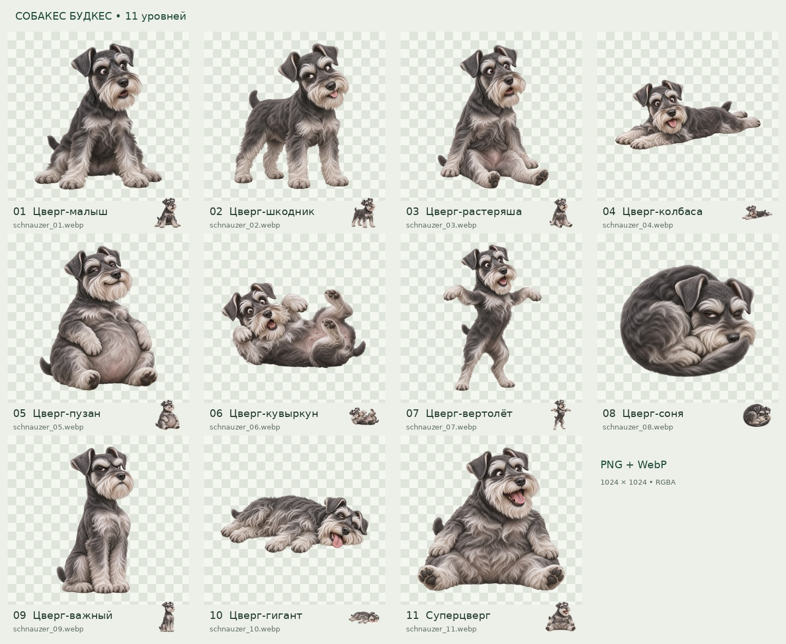

# Собакес Будкес 🐶

**«Собакопад»** — браузерная физическая головоломка: смешные цвергшнауцеры в полный рост падают в коробку, переворачиваются и складываются друг на друга. Два одинаковых уровня сливаются в следующий.

Все 11 персонажей — цвергшнауцеры с разными позами, эмоциями и силуэтами. Размер растёт в движке. Изображения подготовлены для индивидуальных составных коллайдеров Matter.js.

## Ассеты

- [Игровые WebP](public/assets/dogs) — 11 файлов с прозрачностью.
- [Мастера PNG](assets/masters/dogs) — 11 файлов 1024×1024 RGBA.
- [Описание серии и промпты](docs/SCHNAUZER_ASSETS.md).
- [Manifest уровней](public/assets/dogs/manifest.json).
- [11 смешных MP3](public/assets/sfx) — случайный выбор при ударах и слияниях; [правила звука](docs/AUDIO.md).

## Документация и статус

[Актуальное ТЗ на игровой процесс, v2.1](docs/MVP_SPEC.md): классический цикл Suika, индивидуальная физика цвергов, слияния, очки, проигрыш, управление и случайные звуки. [Спецификация изображений](docs/SCHNAUZER_ASSETS.md) описывает готовую серию.

**Подготовка MVP.** В репозитории готовы ТЗ, 11 PNG, 11 игровых WebP и 11 MP3. Код игры и публичная игровая версия пока не реализованы. Следующий этап — реализация по ТЗ и проверка коллайдеров в Matter.js.
